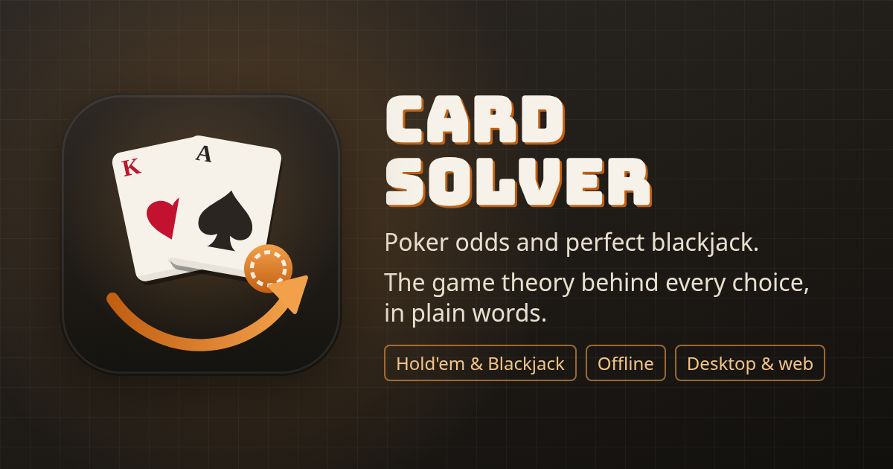
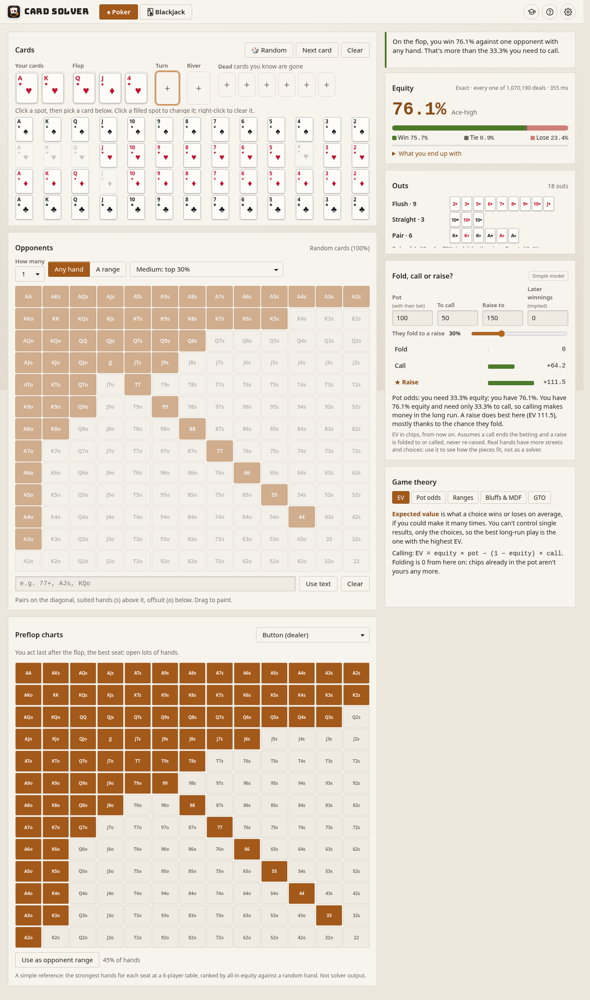
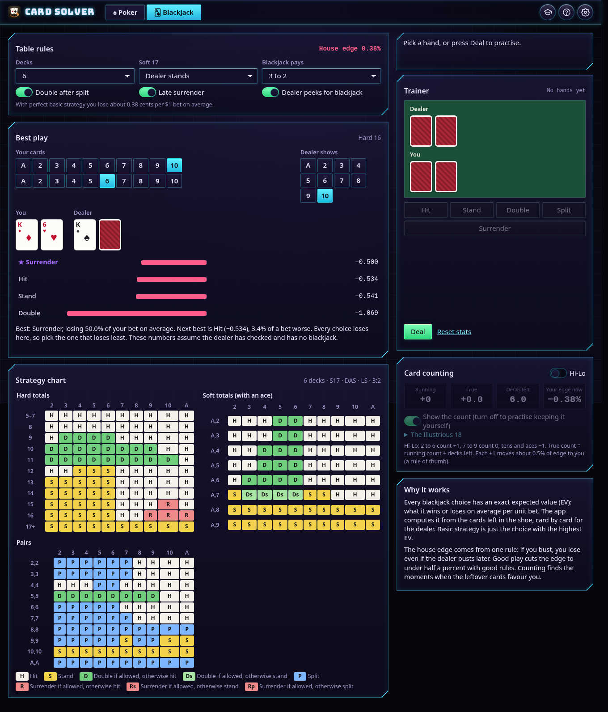
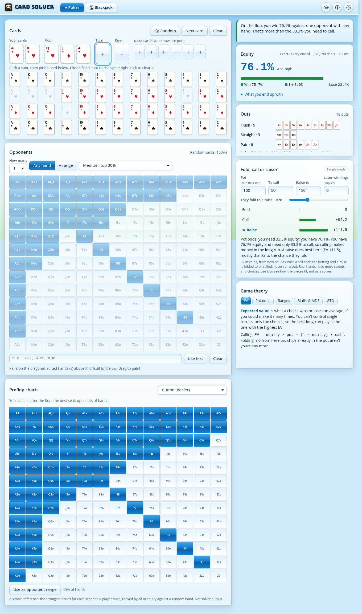
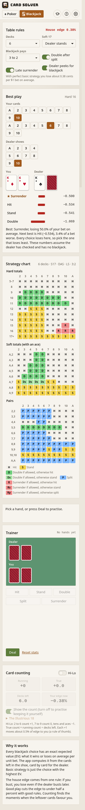

<p align="center"></p>

# Card Solver

**Poker odds and perfect blackjack, with the game theory behind every choice explained in plain words.**

Card Solver is one app with two tabs:

- **Poker (Texas Hold'em):** pick your cards and the board and see your equity against random hands or a range you paint. It also shows your outs, pot odds and a fold/call/raise call with the EV of each choice.
- **Blackjack:** set the table rules and see the exact expected value of every action for any hand against any dealer card. You also get a full strategy chart, a trainer that scores your choices, and optional Hi-Lo card counting.

It runs in the browser, installs as an offline app (PWA), and ships as a Windows desktop app (Tauri 2). It is the fourth app in the suite after Cube Solver, Big Cube and Sudoku Solver, and shares their four looks (Matte, Frutiger Aero, Neon, Neubrutalism), each in light and dark.

> Card Solver is a learning tool. It does not play for money, connect to any site or give financial advice. See [Play responsibly](#play-responsibly).

| Poker | Blackjack |
|---|---|
|  |  |

## Contents

[Features](#features) · [Quick start](#quick-start) · [Tutorial](#tutorial) · [Controls and shortcuts](#controls-and-shortcuts) · [The game theory](#the-game-theory) · [How the engines work](#how-the-engines-work) · [Theming](#theming) · [Building and packaging](#building-and-packaging) · [Troubleshooting](#troubleshooting) · [Architecture](#architecture) · [Testing](#testing) · [Releasing](#releasing) · [Brand assets](#brand-assets) · [Play responsibly](#play-responsibly) · [License](#license)

## Features

### Poker
- **Card picker:** fill your two cards, the flop, turn and river, plus up to six dead cards (cards you know are out). Click a spot, then a card. You can also type a card, for example `a` then `h` for A♥. **Random** deals you a hand and **Next card** deals the next street.
- **Opponents:** 1 to 8. Each holds **any hand** or a **range** you paint on a 13×13 grid. Drag to paint, type a range like `77+, ATs+, KQo`, or start from a preset (top 7%, 15%, 30%, 50%, premium).
- **Equity:** your share of the pot if everyone went to showdown, split into win and tie, plus a breakdown of the hands you end up with. Against one opponent the app counts every possible deal exactly when there are up to 1.2 million of them; otherwise it runs a Monte Carlo simulation in a background thread and shows its progress.
- **Outs:** the cards that improve your hand, grouped by what they make (flush, straight, trips…). It shows the exact chance of hitting next to the "rule of 4 and 2" estimate. It only counts outs that improve your own hand, not cards that improve the board for everyone.
- **Fold, call or raise?** Enter the pot, the bet to call, your raise size, how often they fold to a raise, and the extra you expect to win later (implied odds). The app shows the EV of each choice as bars and explains the best one. This is labelled **simple model**: one decision, then showdown. It is not a solver.
- **Game theory panel:** EV, pot odds, ranges, bluffing and MDF, and what GTO means, all filled in with the numbers on screen.
- **Preflop charts:** a reference opening range for each seat at a 6-player table (UTG 15% to BB 55%). One click turns a chart into the opponent range.

### Blackjack
- **Table rules:** 1, 2, 4, 6 or 8 decks; dealer hits or stands on soft 17; double after split; late surrender; blackjack pays 3:2, 6:5 or 1:1; dealer peeks or not. The **house edge** for those rules updates live.
- **Best play:** pick any two cards and a dealer card to get the exact EV of hit, stand, double, split and surrender, with the best one starred and a plain explanation.
- **Strategy chart:** hard totals, soft totals and pairs for your rules, colour-coded. Click any cell to load that hand into Best play.
- **Trainer:** deals from a real shoe. You make the first decision with the keyboard or buttons, it tells you if that was the best play and what a mistake cost, then plays the hand out. It tracks your accuracy, streak and the total EV you gave away.
- **Card counting (optional):** Hi-Lo running count, true count, decks left and your edge now. You can hide the count to practise keeping it yourself. The trainer switches to the **Illustrious 18** deviations (and insurance at +3) when the count calls for them, and the I18 table highlights the one that applies.

### Everywhere
- Spotlight **tour** with live examples on each step, plus 13 short **lessons** with a quiz each (hand rankings to deviations).
- Four looks × light/dark, defaulting to **System**. The layout stays put while numbers change: panels have fixed heights and numbers use tabular figures.
- Works offline as a PWA; desktop app with an update check (Settings → Updates, desktop only).
- Keyboard first, screen-reader labels on every control.

## Download

Windows installers are on the [Releases page](https://github.com/ccharafeddine/card-solver/releases) once a version is tagged. The binaries are unsigned; SmartScreen may ask you to choose **More info → Run anyway**.

## Quick start

```bash
npm ci
npm run dev        # http://localhost:5176
npm test           # unit tests
npm run lint
```

Requires Node 20+.

## Tutorial

The first visit offers **Tour the app** or **Learn the ideas**. Both stay available from the graduation-cap button.

**Tour (14 steps).** Each step lights up one part of the app and sets up a live example: A♥ K♥ on Q♥ J♦ 4♥, a painted range, a call decision, a 16-vs-10 blackjack hand, a trainer deal, a counting shoe. Everything you had (cards, ranges, rules, the trainer hand and the shoe, the tab you were on) is put back when the tour ends.

**Lessons (13).** Each is a short page, a question and an explanation. The answers are checked against the real engines in the tests.

| # | Lesson | Question |
|---|---|---|
| 1 | Hand rankings | Which hand wins? |
| 2 | Equity | AA vs KK all-in preflop |
| 3 | Outs | Flush draw on the flop: chance to hit by the river |
| 4 | Pot odds | Equity needed to call 50 into 100 |
| 5 | Expected value | EV of calling with 40% |
| 6 | Implied odds | When a call that looks bad is good |
| 7 | Ranges | How many ways to hold AK suited |
| 8 | Bluffing and MDF | How often to defend against a pot-sized bet |
| 9 | Position | Why the button plays more hands |
| 10 | Basic strategy | 16 against a dealer 10 |
| 11 | House edge | Which rule costs you most |
| 12 | Counting | Running count to true count |
| 13 | Deviations | When the count changes the play |

Progress is saved under `card-solver-tutorial` in local storage.

## Controls and shortcuts

| Key | Action |
|---|---|
| `1` / `2` | Poker / Blackjack tab |
| `?` | Help |
| **Poker** | |
| rank then suit (`a` `h`, `t` `s`…) | Put that card in the selected spot |
| `Backspace` / `Delete` | Clear the selected spot |
| `r` | Random hand |
| `n` | Next card (deal the next street) |
| Right-click a filled spot | Clear it |
| **Blackjack trainer** | |
| `Enter` / `Space` | Deal |
| `h` `s` `d` `p` `u` | Hit, stand, double, split, surrender |

## The game theory

The app explains its numbers instead of just showing them. In short:

- **Expected value (EV)** is what a choice wins or loses on average if you could repeat it many times. The best long-run play has the highest EV, even when it loses this time.
- **Pot odds:** to call `C` into a pot of `P` (which already includes the bet), you need equity of at least `C / (P + C)`. Calling 50 into 100 needs 33%.
- **Implied odds** add the chips you expect to win later: needed equity = `C / (P + C + future winnings)`.
- **Ranges:** players do not have one hand, they have a set of hands. There are 1,326 starting combinations in 169 classes: 6 ways to hold a pair, 4 for a suited hand, 12 for an offsuit one.
- **Minimum defence frequency (MDF):** against a bet `B` into a pot `P`, defend at least `P / (P + B)` of the time, or the bettor profits by bluffing with anything. Pot-sized bet: defend 50%.
- **Bluff share:** a balanced bettor bluffs `B / (P + 2B)` of the time, which makes the caller's call break even. Pot-sized bet: one bluff for every two value bets (33%).
- **GTO** (game theory optimal) means a strategy that cannot be exploited. Card Solver does **not** compute GTO. Its decision model is deliberately simple, and the panel says so.
- **Blackjack** has no opponent making choices, so the best play is pure maths: the action with the highest EV given the cards left. Basic strategy is that, summarised. Counting tracks which cards are left, so you can bet more when they favour you and occasionally play differently.

## How the engines work

### Hand evaluator (`src/poker/eval.ts`)
Cards are integers `rank × 4 + suit` (rank 0 = deuce … 12 = ace; suits c d h s). The evaluator scores the best 5 of 5–7 cards into one number: `category × 16⁵` plus five 4-bit kicker ranks, so a higher number is always a better hand. It uses rank counts and a per-suit bitmask for flushes and straights, with no lookup tables. It runs about 1.1 million 7-card evaluations a second in a browser.

### Equity (`src/poker/equity.ts`)
- **Exact** for one opponent when the number of deals (opponent combos × board completions) is at most `EXACT_LIMIT` = 1,200,000: every deal is evaluated and ties count as half.
- **Monte Carlo** otherwise: random opponent hands (drawn from each range, with card removal) and random boards from a seeded generator, with progress every 20,000 trials. The error at 200k trials is about ±0.1%.
- It runs in a Web Worker (`src/worker.ts`), so the page never freezes. A new request cancels a busy one by restarting the worker.

### Ranges and charts
The 13×13 grid puts pairs on the diagonal, suited hands above it and offsuit below. `STRENGTH` (`src/poker/strength.ts`, made by `tools/gen-strength.ts`) is every class's equity against one random hand from 60,000 deals (AA 85.1%). It orders the "top x%" presets and the seat charts. The charts are therefore a **reference ranked by strength, not solver output**.

### Decision model (`src/poker/decide.ts`)
`pot` includes the opponent's bet. EV(fold) = 0; EV(check) = equity × pot; EV(call) = equity × pot − (1 − equity) × call. EV(raise to `r`) = fold% × pot + (1 − fold%) × (equity × (pot + 2r − call) − r). It assumes the hand goes to showdown after the call or raise. It ignores later streets apart from the implied-odds input.

### Blackjack EV (`src/blackjack/engine.ts`)
- A shoe is `counts[1..10]`, with tens grouped.
- `dealerDist` gives the dealer's final-total distribution (17–21, bust, blackjack) by recursion over the exact cards left, with card removal, memoised on the cards drawn. It follows H17/S17.
- The player's EVs come from recursion over hit/stand/double on the shoe after removing the initial three cards.
  - Splits are one split, no resplit; split aces get one card each; DAS is honoured.
- With **peek**, EVs are conditioned on the dealer not having blackjack (what you face when you get to act). Without peek, a dealer blackjack takes the whole doubled or split bet ("lose all").
- Surrender is offered only with peek (late surrender).
- `gameEV` weighs every starting hand and upcard to give the house edge. Example: 6 decks, S17, DAS, late surrender, 3:2 gives −0.38%, which matches published figures.

### Counting (`src/blackjack/counting.ts`)
Hi-Lo: 2–6 count +1, 7–9 count 0, tens and aces count −1. True count = running count ÷ decks left. The edge estimate is the base edge + 0.5% per true count. The Illustrious 18 deviations are stored as (hand, upcard, index, play) and applied when the true count passes the index.

## Theming

Same system as the rest of the suite: `src/theme/tokens.css` declares every colour, radius and shadow per skin and mode, and components use only those tokens (a test enforces it). The one exception is the playing cards: real cards are white with red and black suits in every theme. Skins: **Matte** (default), **Frutiger Aero**, **Neon**, **Neubrutalism**, each light/dark, plus **System**, which follows the OS until you pick a mode.

| Aero light | Phone |
|---|---|
|  |  |

## Building and packaging

### Web
```bash
npm run build      # type-check + production build to dist/
npm run preview    # serve dist/
```
`dist/` uses relative paths, so it works from any static host or sub-folder. Set `SITE_URL` at build time to make the social-card tags absolute (`og:url`, `og:image`). `wrangler.jsonc` deploys `dist/` to Cloudflare as static assets with no routes, so you choose the domain in the dashboard.

### PWA
Serve `dist/` over https and install from the address bar (or **Add to Home Screen**). `public/sw.js` fetches pages network-first and assets cache-first.

### Desktop (Windows, Tauri 2)
Needs Rust stable, the Microsoft C++ Build Tools, WebView2 and about 10 GB free.
```bash
npm run desktop:dev   # desktop window against the dev server
npm run desktop       # installers in src-tauri/target/release/bundle/
```

## Troubleshooting
- **Port 5176 in use:** change `server.port` in `vite.config.ts` and `devUrl` in `src-tauri/tauri.conf.json` together.
- **Equity says "Monte Carlo" when you expected exact:** exact counting is only for one opponent and up to 1.2M deals. Preflop against a wide range is far more than that.
- **Equity looks stuck:** the worker restarts on every change; if you change cards quickly, only the last request finishes.
- **Desktop build fails with "no space on device":** free 10 GB and delete `src-tauri\target`.
- **SmartScreen blocks the installer:** unsigned binaries; **More info → Run anyway**.
- **The PWA shows an old version:** reload once while online.

## Architecture

```
src/
  main.ts              app shell: tabs, theme, dialogs, keyboard, tour demos
  worker.ts            background equity and blackjack EV
  poker/               cards, eval, range, strength, equity, outs, decide, charts (+ tests)
  blackjack/           engine (EV, chart), counting (Hi-Lo, I18), shoe (+ tests)
  ui/                  cards.ts (card faces), poker.ts, blackjack.ts
  tutorial/            lessons + tour content, coach, spotlight
  theme/               tokens, skins, brand and layout tests
  app/update.ts        desktop update check (GitHub releases)
  build/siteMeta.ts    SITE_URL social tags
tools/gen-strength.ts  regenerates the strength table
brand/                 icon generator, OG card, asset inventory
src-tauri/             desktop shell
```

State is saved in local storage under `card-solver-poker`, `card-solver-blackjack`, `card-solver-tab`, `card-solver-skin`, `card-solver-theme` and `card-solver-tutorial`. Everything loads defensively: corrupt data falls back to defaults.

## Testing

```bash
npm test
```
- **Poker:** evaluator categories and kicker order; exact vs Monte Carlo agreement; known equities (AA vs KK ≈ 82%, AhKh on 7h2h9c vs 99 ≈ 24.6%); range parsing and combo counts; outs; pot odds, EV and MDF formulas.
- **Blackjack:** dealer distributions sum to 1; known house edges by rule set; the chart matches published basic strategy; counting and I18 lookups.
- **Tutorial:** every lesson answer is checked against the engines; tour steps with examples name their tab.
- **Theme and layout:** tokens only, fixed panel heights, title and icons.

CI (`.github/workflows/ci.yml`) runs lint, type-check, tests and a build on every push.

## Releasing
Bump the version in `package.json`, `src-tauri/tauri.conf.json` and `src-tauri/Cargo.toml`, add `docs/release-notes/vX.Y.Z.md`, and push a `vX.Y.Z` tag. The release workflow builds the Windows installers and publishes them with those notes.

## Brand assets
`python3 brand/make-icon.py` draws the mark (an ace and a king fanned with an amber chip and the suite's solve arrow). See `brand/INVENTORY.md` for how every PNG, the OG card and the desktop icons are made. All artwork is original; the title font is Bungee (SIL OFL).

## Play responsibly
Card Solver teaches maths. Over time, every casino game has a house edge, and no strategy or count makes gambling a way to earn money. If gambling stops being fun, call **1-800-GAMBLER** (US) or visit your local support service.

## License
MIT © ccharafeddine
